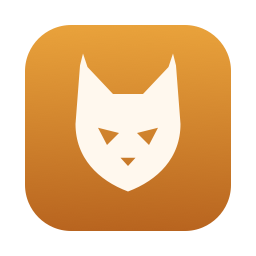

<div align="center">
    
    <h1>Lynx Bar</h1>
</div>

Lynx Bar is a menu bar manager for macOS 14 and later. It hides and shows menu bar items,
shows hidden items in the **Lynx Shelf** below the menu bar (handy on notched MacBooks),
lets you arrange items by dragging, search them, and change the menu bar's appearance.

Lynx Bar is a fork of [Ice](https://github.com/jordanbaird/Ice) by Jordan Baird, based on
Ice's unreleased macOS 26 work, and is licensed under the [GPL-3.0](LICENSE) like Ice.

> [!NOTE]
> There are no release downloads yet. Build it yourself as described below.

## Build it yourself

You need macOS 14 or later and Xcode (the full app, not only the Command Line Tools).

1. **Create a code-signing certificate (once).** Lynx Bar's helper only talks to an app
   signed with the same certificate, and macOS only keeps Lynx Bar's permissions across
   rebuilds when it's signed with a certificate. A free self-signed one is enough:
   Keychain Access → Certificate Assistant → Create a Certificate…, choose a name, Identity
   Type **Self Signed Root**, Certificate Type **Code Signing**. It's fine that Keychain shows
   it as "not trusted".
2. **Point the build at it.** `cp Config/Local.xcconfig.example Config/Local.xcconfig`, then
   set `CODE_SIGN_IDENTITY` to your certificate's name. This file is gitignored.
3. **Build.**

   ```sh
   xcodebuild -project LynxBar.xcodeproj -scheme LynxBar -configuration Release build
   ```

   Copy `Lynx Bar.app` from the build products into `/Applications`. On macOS 27 it must be
   there to hide items (see below); on earlier versions `~/Applications` works too.
4. **Grant permissions.** On first launch Lynx Bar asks for Accessibility (required) and
   Screen Recording (for the Lynx Shelf and item images). Quit and reopen it after granting
   Screen Recording.

Without a certificate the build still succeeds, but Lynx Bar can't start its helper and shows
a message in place of your menu bar items.

## macOS 27

macOS 27 draws every menu bar item in one system process, `MenuBarAgent`, so the usual
trick of pushing items off screen no longer works. Lynx Bar hides apps there through
MenuBarAgent's allowlist, a private macOS facility that other menu bar managers also use:

- **Choose what's hidden** by ⌘-dragging an app's icon left of the "|" divider, as before.
  Hiding works per app, so an app with several icons hides as a whole.
- **Show hidden apps** by clicking the Lynx icon, or by hovering over it with "Show on hover"
  on. They reappear in place and hide again by your rehide settings. Rehiding waits while a
  revealed app has a menu or panel open.
- **Lynx Bar must run from `/Applications`.** macOS ignores the allowlist for apps that run
  from anywhere else. Lynx Bar then shows a note in General settings and falls back to the
  system's `«` overflow, where macOS decides what's hidden by what fits.
- Apple's own icons can't be chosen, and Now Playing and Focus also hide while a section is
  hidden.
- The Lynx Shelf works on macOS 27 while hiding through the allowlist works. Opening it
  draws the hidden icons in the menu bar for a moment to capture them, and clicking one
  shows that app's icon in the menu bar until its menu closes. To move an item to another
  section, turn the Shelf off, show the hidden items and ⌘-drag it. Without the allowlist,
  "Use Lynx Shelf" opens the `«` instead.
- Search and the Menu Bar Layout pane aren't available on macOS 27 yet, because the system
  doesn't let apps list other apps' items.

Since the facility is private, a macOS update could change it. If it stops working, Lynx
Bar falls back to the `«` overflow. See [FREQUENT_ISSUES.md](FREQUENT_ISSUES.md) for more.

## Coming from Ice

On first launch Lynx Bar copies your Ice settings (sections, hotkeys, appearance, shelf
settings). Ice's own settings aren't changed. Permissions and "Launch at login" need to be
set again.

## License

Lynx Bar is available under the [GPL-3.0 license](LICENSE). It is based on Ice, © Jordan
Baird, also GPL-3.0.

Parts of the macOS 27 support are ported from [IceMelt](https://github.com/pnikolaidis/icemelt),
another GPL-3.0 fork of Ice.
